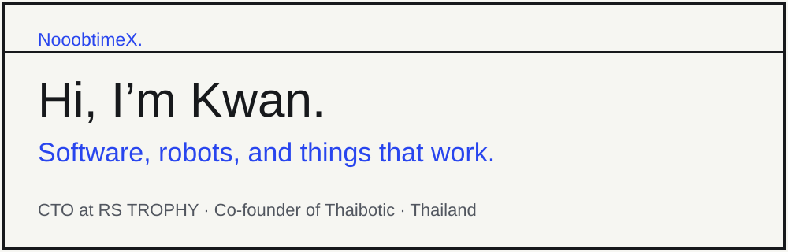
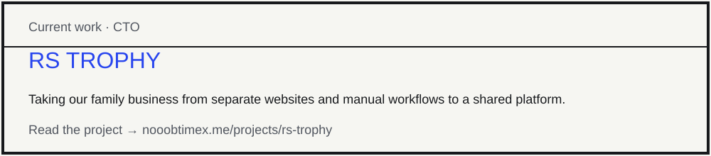
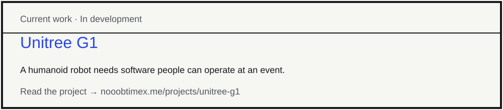
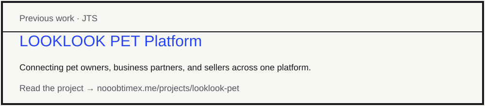
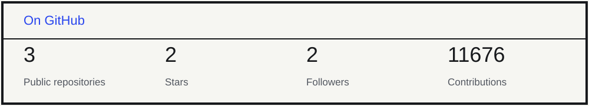
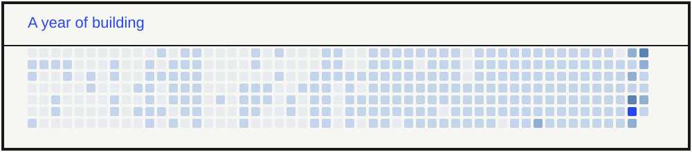

<!-- Artwork is generated by bun run readme:assets; activity refreshes weekly. -->



I'm **Wongsaphat Puangsorn**, usually **Kwan (ขวัญ)** or **NooobtimeX** online. I'm the CTO at [RS TROPHY](https://rs-trophy.com) and co-founder of [Thaibotic](https://thaibotic.com). I build the software behind our family business, work with a humanoid robot, and make a Roblox game in my own time.

[Get to know me](https://nooobtimex.me/career) · [Projects](https://nooobtimex.me/projects) · [Writing](https://nooobtimex.me/blog) · [Say hello](mailto:nooobtimex@gmail.com)

## A few things I've built

[](https://nooobtimex.me/projects/rs-trophy)
[](https://nooobtimex.me/projects/unitree-g1)
[](https://nooobtimex.me/projects/looklook-pet)

## Notes from the work

I write about architecture, infrastructure, and the practical details of building and running systems. [Read the journal →](https://nooobtimex.me/blog)

## On GitHub




[GitHub activity details](https://nooobtimex.me/github) · [LinkedIn](https://www.linkedin.com/in/nooobtimex) · [YouTube](https://www.youtube.com/@nooobtimex) · [Instagram](https://www.instagram.com/nooobtimex)

## This repository

The source for [nooobtimex.me](https://nooobtimex.me), my personal website. Next.js, React, TypeScript, Tailwind, and Bun. A white comic design with bold ink frames, interactive 3D, real work, and plain-language stories. Hosted on Railway.

```sh
bun install --frozen-lockfile
bun run dev
```

Development runs on port **11000**. `bun run gate` runs lint, formatting, project checks, type checking, the production build, internal-link/SEO/bundle checks, and agent-document checks. `bun run readme:assets` refreshes the artwork above; `bun run llms:generate` updates the machine-readable profile.
